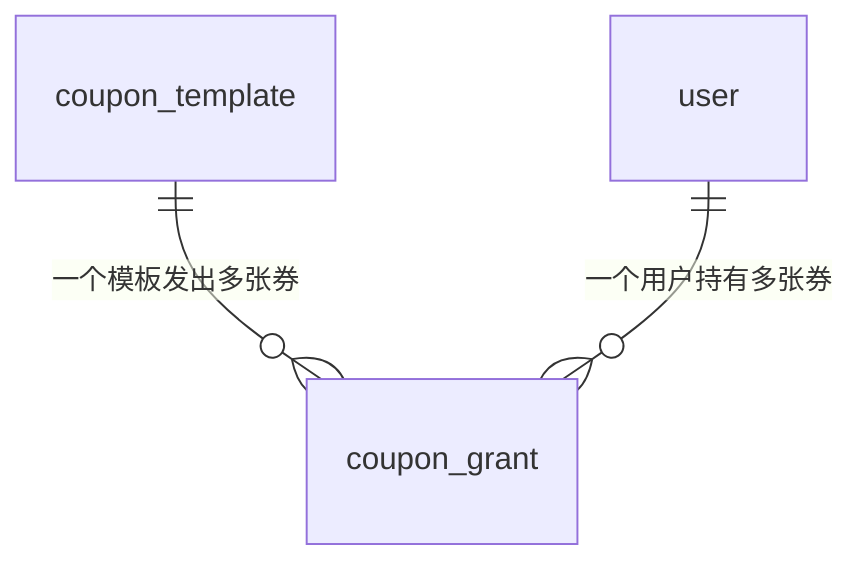

# 表设计

## 前置卡口

**需求分析的未决项必须全部清零，才能动表设计。**

带着「有效期是绝对时点还是领取后 N 天」这种没定的问题往下走，建出来的表是按假设建的——假设被推翻就不是改几个字段，是重新建模。**不许用「先按建议默认值做」绕过去。**

---

## 一、结构

```
1  表清单    | 表名 | 用途 | 新建 / 改动 |
2  ER 图     mermaid erDiagram，把关联关系画出来
3  字段表    每张表一张，索引写在表里
4  存量迁移  只有老表加字段才写；没有就一行「无」
```

**不写 DDL。** 实现的时候照字段表推导进迁移脚本即可。文档里再写一份 DDL 的后果是：review 改一个字段要同时改字段表和 DDL 两处，漏改一处就分叉。

**不定义枚举的取值。** 表设计只说明这一列**用数字还是字符串代指**，具体档位和含义在代码的枚举类里。库里存 `1` 还是 `'ACTIVE'` 是表设计的事，`ACTIVE` 叫什么、有哪几档是代码的事。

---

## 二、字段表

固定六列：

| 字段 | 类型 | 含义 | 可空 | 索引 | 取值来源 |
|---|---|---|---|---|---|

**「索引」列写法**：`PK` · `UK`（跟谁组成联合唯一就写 `UK(a,b)`）· `IDX` · `IDX(a,b)` 联合索引 · 空着表示不建。
联合索引在**第一列**那一行写全 `IDX(a,b,c)`，后面几列留空，别重复写三遍。

### 五条硬规则

**1 · 第一列必须是代码里真实的名字**——JSON 键名或 Java 字段名。中文只进「含义」列。
写「订单号」而不是 `orderNo`，对面做穷尽校验时键名对不上，**整单作废且失败是静默的**。

**2 · 类型单一确定。** 不许写「字符串 **或** 键值对」——强类型语言里表达不了，写代码的人只能自己发明形状。真有互斥形态用封闭类型（`sealed interface` + 几个 `record`），把互斥性交给编译器。

**3 · 新建表给全字段名、类型、可空三样。** 只给「这张表要能存 XX」这种概念列，结果是每个人拼一套不同的列名。

**4 · 字段形状要跟业务规则对得上。** 业务说「附件是数组、至少一张」，就不能给单数的一对列——这种自相矛盾会让人推翻整个建模假设。

**5 · 不推给另一份文档。** 「完整字段见某某汇总表」，在那份文档对方读不到时**等于没写**。

### 「含义」列要写进去的东西

- **单位**：`满减门槛，单位分（10000 = 100.00 元）`。漏了单位会算错 100 倍，**而且不抛异常**
- **代指关系**：`状态，字符串代指，值域见 CouponStatus`
- **反向警告**：`只增不减，不要先查后改` / `本期恒 NULL，不要依赖它做判断`
- **为什么是这个形状**：尤其是选了 JSON 列而不是拍平成多列这种决定

---

## 三、ER 图

关联关系用 `mermaid erDiagram` 画，不用文字描述——三张表以上纯文字就读不动了。



图上要标清**一对多还是多对多**。**建不建数据库外键、级联怎么处理**在图下补一行说明——这两件图上画不出来。

---

## 四、存量迁移

**只有往已有的表加字段 / 改类型 / 加约束时才写这一节。** 全是新建表就写一个字「无」。

要写的时候只写三样：加什么 → 怎么回填 → 能不能回滚。回填要说清**跑多久、锁不锁表、能不能分批**。

---

## 五、Review 检查清单

**这几条是 review 时逐条过的，不是要写进文档的内容。**

- [ ] **密度**：有没有把一格能装下的事实另起一段再补推导——挑三段正文，逐段问「这段里有没有哪句该在某个表格的格子里」，有就搬回去
- [ ] **密度**：禁用语 `grep` 零命中（命令见 `SKILL.md`），表格单元格没有超 60 字的
- [ ] 金额：用分整数还是 `BigDecimal`？**有没有出现 `double` / `float`**？有除法的话舍入规则定了吗
- [ ] 时间：存 UTC 还是本地？时区基准是哪个？「当前时间」走不走时钟抽象（不走就造不出过期场景的测试）
- [ ] `NOT NULL` 逐个对着入口核：**每条能写这张表的路径，这一列都有值可填吗？** 没有就是插不进去，而且运行时才发现
- [ ] 唯一索引写清防的是什么（幂等？防重复提交？），不是只写「加个唯一索引」
- [ ] 部分索引的条件外行为说了吗
- [ ] 多租户：这张表要不要行级安全？**没有请求上下文的入口（定时任务、回调）租户值从哪来？** 不设会查不到任何一行**且不报错**
- [ ] 字段表第一列全是真实字段名，没有中文
- [ ] 没有「A 或 B」式的类型
